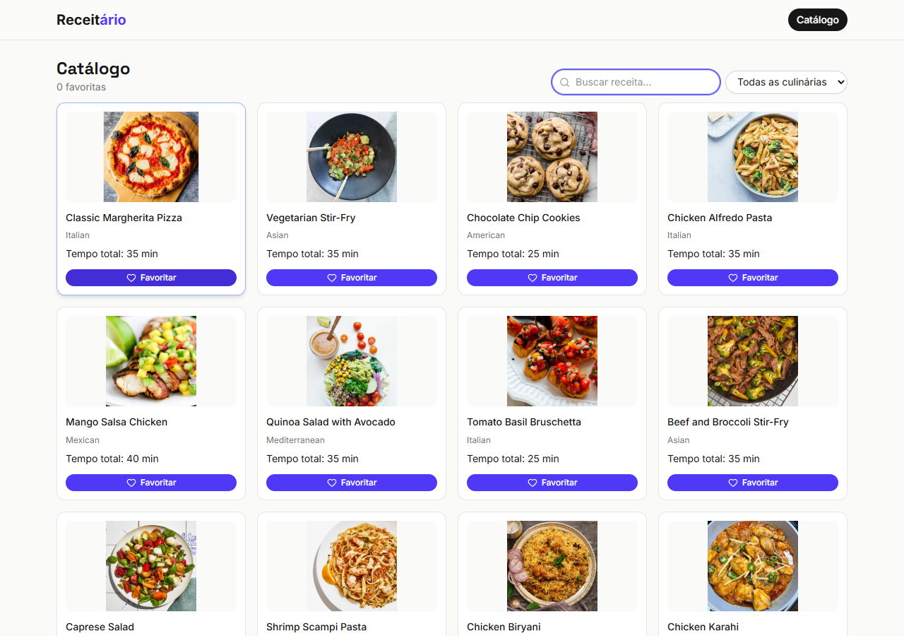

# Receitário

Checkpoint 5 - catálogo de receitas em React + Vite + TypeScript, consumindo a DummyJSON.

## Integrantes

| Nome | RM | GitHub |
| --- | --- | --- |
| Henrique da Silva Muniz | 573874 | henriquemunizz |
| Erick Keiji Miyashiro | 568966 | erickmiyashiro |

## Deploy

Pendente: URL pública do deploy na Vercel.

## Catálogo



## Executar

```sh
npm install
npm run dev
```

```sh
npm run build
```
